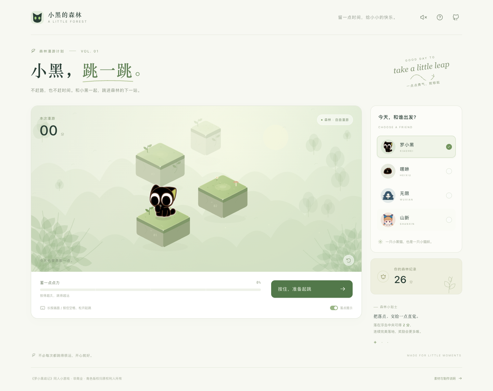

# 小黑，跳一跳 🌿

和小黑一起，在森林浮岛之间轻轻一跃。基于《罗小黑战记》的免费、非商业同人小游戏，使用 HTML、CSS 和原生 JavaScript / Canvas，直接托管在 GitHub Pages。

**[打开游戏](https://line-ar-line.github.io/luoxiaohei-jump/)**



## 玩法

- 鼠标 / 触屏：按住画面或绿色按钮蓄力，松手起跳。
- 键盘：按住空格蓄力，松开起跳；Esc 取消蓄力。
- 系统自动朝下一座浮岛起跳，按得越久，跳得越远。
- 普通落地得 1 分。中心落地从 2 分起，连续中心落地逐次加分，最多每跳 6 分。
- 跳回当前浮岛不会加分；掉入空隙后可重新开始。
- 可切换罗小黑、嘿咻、无限、山新；切换角色会重新开始，四个角色能力一致。
- 默认打开落点提示，可手动关闭。音效默认关闭，需要时点击右上角扬声器。
- 最高分、角色、音效与提示偏好存于本机浏览器，不含广告、统计或联网账号。

## 本地运行

不需要安装前端依赖或构建。请通过 HTTP 访问，直接双击 HTML 会影响模块与图片清单加载。

```sh
python3 -m http.server 8765 --bind 127.0.0.1
```

访问 `http://127.0.0.1:8765/`。

## 验证

规则测试不需要第三方依赖：

```sh
npm test
```

浏览器验证覆盖鼠标 / 空格 / 触屏起跳、计分、失败重试、角色切换、最高分保存、模态窗、窄屏布局和 Pages 子目录路径：

```sh
npm install
npx playwright install chromium
npm run test:browser
```

若使用已安装的 Chrome，可设置 `BROWSER_EXECUTABLE` 为浏览器可执行文件路径。浏览器测试自行启动临时 HTTP 服务，无需先运行本地服务。

## GitHub Pages

使用 GitHub Pages 原生分支发布：仓库的 Settings → Pages → Source 设置为 **Deploy from a branch**，选择 **main / (root)**。每次推送 `main` 都会自动更新网页，不需要自定义 Actions 工作流或额外令牌权限。`.nojekyll` 禁止对静态源文件做 Jekyll 处理。游戏运行时只请求 HTML、CSS、游戏 JS 与已处理角色图片，不会让玩家下载原始参考素材。

发布更新前请先运行 `npm test` 和 `npm run test:browser`。

所有素材路径均相对当前网页，因此可部署到 `https://用户名.github.io/仓库名/`。

## 项目结构

| 文件 | 内容 |
| --- | --- |
| `src/main.js` | 页面、输入、角色选择、声音、浏览器存储 |
| `src/game.js` | 游戏状态、跳跃、落点判定、程序绘制森林 |
| `assets/characters/manifest.json` | 角色图片与来源映射 |
| `assets/characters/SOURCES.md` | 原图固定链接、角色核对与加工记录 |
| `assets/references/` | 原始下载素材，仅开发、核对与重复生成使用 |
| `tools/build_character_assets.py` | Pillow 裁切、透明背景与动作差分脚本 |
| `tests/` | 规则与浏览器测试 |

## 角色素材

角色图片实际下载自公开的 [IXiaoHei](https://github.com/jiang-taibai/IXiaoHei) 与 [2048LXH](https://github.com/Hakuin123/2048LXH) 素材仓库，并经萌娘百科角色页面核对。完整来源见 [素材记录](assets/characters/SOURCES.md)。

小黑、嘿咻使用原素材裁切；无限、山新使用 Q 版半身图，作为棋子。每个角色提供待机、蓄力、跳跃、掉落四种透明 PNG 差分。差分由原图裁切、缩放和旋转制作，**不是官方新增动作或原画**。原素材分辨率有限，后续可以在不改游戏逻辑的情况下替换为更清晰的精灵图。

需要重新生成素材时：

```sh
python3 -m pip install Pillow
python3 tools/build_character_assets.py
```

森林背景、浮岛与植物由 Canvas 绘制，游戏音效通过 Web Audio API 合成。角色及作品版权属于相应权利人，项目不声称拥有角色素材，也不将角色图像作为原创素材重新许可。
